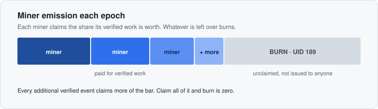

# Alpharidge AI (Subnet 45)

Subnet 45 finds real-world events as they happen and turns each one into a structured record with the source that proves it. It is the event layer behind **[AlphaRidge](https://alpharidge.ai)**.

Miners search the open web for new events in finance, technology, politics and sports (a merger, a rate decision, a funding round, a bill passed, a player transfer) and send each one as a signed claim with a source URL. The first miner to report an event from a trusted source wins it. A miner who finds it first anywhere else holds it as a scoop: paid five times the price if a trusted source confirms it later, charged double as debt if none does. Validators judge the pages, confirm scoops, verify the signed ledger and set weights.

**Guides:** [Running a miner](docs/miner.md) · [Running a validator](docs/validator.md) · [How the mechanism works](docs/mechanism.md)

---

## Who does what

| Role | Job |
|---|---|
| **Miner** | Watches any sources it likes, spots new events and sends each as a claim with the URL that proves it |
| **Coordination API** | Stamps receipt time, decides whether the event is new, checks the claim against its page, scores source trust and keeps a signed ledger of points |
| **Validator** | Judges claims' pages, scans trusted sources to confirm scoops, verifies the ledger, re-checks paid claims on its own and sets weights |

Finding is the hard part and checking is cheap: validators never search the open web, they fetch the pages miners point to and read the trusted sources' feeds.

---

## Categories and event types

| Category | Types |
|---|---|
| Finance | `monetary_policy`, `economic_data`, `earnings`, `merger_acquisition`, `bankruptcy`, `personnel`, `layoffs`, `delisting`, `ipo_listing`, `trading_halt` |
| Technology | `product_launch`, `breakthrough`, `funding`, `partnership`, `security_incident`, `outage`, `vulnerability`, `tech_regulation`, `infrastructure_investment` |
| Politics | `election_result`, `legislation_passed`, `appointment`, `sanction_or_tariff` |
| Sports | `transfer`, `injury`, `award`, `match_result` |

Other types are rejected as `type_off`, and price moves are never events. The category follows from the type. Each type has fixed fact slots, and names link to registry IDs (Wikidata, SEC CIK, LEI). [docs/miner.md](docs/miner.md) lists every type with its sources and key facts.

---

## The life of a claim

```
miner ── signed claim + source URL ──► API
                                        │ receipt time stamped on arrival
                                        ▼
                                  Is it new?  ── known ──► nothing
                                        │ new
                                        ▼
                               Is the source trusted? ── no ──► held as a scoop until a
                                        │ yes                    trusted page confirms it (72 h)
                                        ▼
                              Does the page say it?  ── no ──► rejected
                                        │ yes
                                        ▼
                         First in line wins: part credited now, the rest after settlement
                                        │
                                        ▼
                     signed ledger ──► validators: verify, re-check, set weights
```

- **New:** same type, subject, place and date window means the same event; a different amount or headline earns nothing more.
- **Trusted:** a reviewed list of official sites, newsrooms and outlets per category. A company's or club's own site counts only for claims that name it.
- **Says it:** the page must be live, recent and openly readable, contain every name and figure in the claim and the miner's quote, and pass the page judge run by the listed validators.
- **First:** by the API's receipt time, with a recomputable draw for ties.

Details: [docs/mechanism.md](docs/mechanism.md).

---

## How pay works

```
points = tier price × source trust × age
```

| Tier | Points | Types |
|---|---|---|
| Low | 3 | earnings, economic_data, monetary_policy, trading_halt, delisting, personnel, ipo_listing, product_launch, partnership, vulnerability, tech_regulation, infrastructure_investment, election_result, legislation_passed, appointment, sanction_or_tariff, injury, award, match_result |
| High | 12 | merger_acquisition, layoffs, bankruptcy, security_incident, funding, transfer, breakthrough, outage |

- **First report only.** Later stages or extra facts on a known event earn nothing.
- **Trust** is 1 for official and company pages, lower for news outlets.
- **Age.** Events up to 30 days old; full pay for 48 hours, sliding to a quarter at 30 days.
- **Scoops** pay 5× when the confirming trusted page comes out after the scoop, 1× otherwise; an unconfirmed or contradicted scoop costs 2× as debt. Rate decisions, data releases, earnings, trading halts, election results and match results can't be scooped.
- **Scheduled releases.** A rate decision, data release, earnings report or trading halt claimed before its official release time is not paid.
- **Wrong claims** are clawed back, with any pay already earned carried as debt on the coldkey. Confirmed misconduct costs 5× the claim's value.
- **One pool.** Every category is priced the same way; the only limit is capacity.

Full rules: [docs/miner.md](docs/miner.md#3-pay).

---

## Where the rest of the emission goes

Each miner's share is its points divided by the larger of total points and capacity. Whatever no verified work claims goes to **UID 189, the burn UID**.

<div align="center">
  <picture>
    <source media="(prefers-color-scheme: dark)" srcset="./emission-bar-dark.svg">
    
  </picture>
</div>

| Condition | What happens |
|---|---|
| Total points below capacity | Each miner is paid its points over capacity. The unclaimed remainder burns. |
| Total points above capacity | Miners split all of miner emission in proportion to points, and burn is zero. |

Live capacity and window: `GET /dashboard/mechanism`. A worked TAO example and how to check the burn UID: [docs/mechanism.md](docs/mechanism.md#emission-capacity-and-the-burn).

---

## Quickstart

```bash
git clone https://github.com/Team-Rizzo/alpharidge-ai.git
cd alpharidge-ai

./install.sh validator     # validator
./install.sh miner         # reference miner (same CPU-only install)
```

Then follow [docs/miner.md](docs/miner.md) or [docs/validator.md](docs/validator.md). Upgrading a 3.x miner: [docs/miner.md](docs/miner.md#upgrading-from-3x). Validators on the auto-updater upgrade on their own.

---

## Project structure

```
alpharidge-ai/
├── neurons/
│   ├── miner.py              # Reference miner entry point
│   └── validator.py          # Validator entry point
├── alpharidge_ai/
│   ├── config.py             # Env settings (.miner_env / .vali_env) and command-line arguments
│   ├── schema/               # Claim model, event types, stages, slots, canonical hashing
│   ├── verify/               # Shared fetch rules and the claim-against-page check
│   ├── judge/                # Page judge prompt, client and verdict combination
│   ├── ledger/               # API client, request signing, signed ledger pulls
│   ├── mechanism/            # settle(), window points, mechanism profile
│   ├── validator/            # Ledger loop, keyed re-check, scoop scan, page judge, mechanism profile client
│   ├── miner/                # Reference miner: feed discovery, entity linking, claim building
│   └── chain/                # Neuron base classes, weight utils, mock chain
├── docs/                     # Miner, validator and mechanism guides
├── profiles/                 # Shape of a mechanism profile (placeholder values)
└── scripts/                  # Validator auto-updater, local end-to-end run
```

The `schema` and `verify` packages are installed in the coordination API as well, so the API and validators reach the same verdict on the same page.

---

## License

MIT
